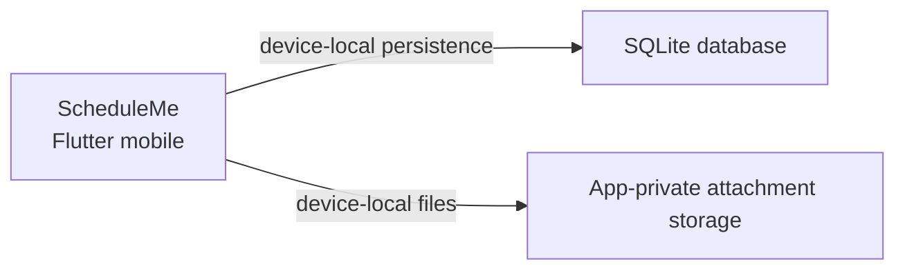

# Azure Debug Plan

> This plan is the source of truth for generating the
> VS Code debug setup in this workspace.
>
> **Status:** Executing
> **Execution Mode:** Guided
> **Created:** 2026-09-22T00:00:00Z
> **Last Updated:** 2026-09-22T00:00:00Z
>
> This is a Flutter mobile application with no Azure services, network API, or containerized local dependency.

---

## Prerequisites

| Tool / Extension | Category | Service(s) | Installed | Version |
|------------------|----------|------------|-----------|---------|
| Flutter SDK | Runtime | mobile | ❓ | Could not be confirmed on PATH |
| Dart SDK | Runtime | mobile | ❓ | Could not be confirmed on PATH; Flutter normally includes Dart |
| Android SDK | Runtime | mobile | ❓ | Standard Windows locations not found |
| Git | Toolchain | * | ✅ | 2.45.2.windows.1 |
| Android Studio | Debug tool | mobile | ❓ | Standard Windows locations not found |
| Android Emulator or physical Android device | Debug tool | mobile | ❓ | Could not be confirmed |
| Flutter VS Code extension (`Dart-Code.flutter`) | VS Code extension | mobile | ❓ | Could not be confirmed |

> ⚠️ **Action required:** Confirm every tool or extension marked ❓ is installed and ready before approving this plan. Docker and Docker Compose are installed but are not required because this app has no emulator-backed dependency.

---

## Debug Configurations

Each checked row below produces a VS Code debug configuration in `.vscode/launch.json`.

| Generate | Debug Config Name | Service Label | Service Root | Project Type | Runtime | Version | Azure Dependencies |
|----------|-------------------|---------------|--------------|--------------|---------|---------|--------------------|
| [x] | ScheduleMe (Flutter) | ScheduleMe mobile | `./` | flutter-mobile | Dart / Flutter | Dart SDK `>=3.3.0 <4.0.0` | — |

ℹ️ Project Type Descriptions

| Project Type | Description |
|-------------|-------------|
| flutter-mobile | Flutter mobile application launched and debugged through the Flutter tooling on an Android emulator or physical device |

---

## Orchestrator

No orchestrator is required. The app stores tasks in device-local SQLite and optional attachments in app-private files; no emulator containers or dependent services are needed.

| Orchestrator | Container Runtime | Compose Command | Description |
|-------------|-------------------|-----------------|-------------|
| None | — | — | No containerized local dependency is present |

---

## Emulators

No Azure or external-service emulator is required.

| Dependent Service | Emulator | Purpose |
|-------------------|----------|---------|
| — | — | The application is fully offline and device-local |

---

## Architecture Diagram

The Flutter application runs on an Android emulator or physical device and persists task data in local SQLite and optional attachments in app-private storage.

---

## Migrations

The project contains `lib/core/database/migrations/001_initial_schema.sql`. `AppDatabase` loads and applies it during local database creation or upgrade, so no separate VS Code migration task is needed.

| Generate | Service | Migration Tool |
|----------|---------|----------------|
| [ ] | ScheduleMe mobile | Raw SQL applied by `AppDatabase` at runtime |

---

## Convenience Scripts

No script runner is defined in this Dart project. The standard Flutter commands remain the supported workflow: `flutter pub get`, `flutter test`, and `flutter run`.

| Generate | Script | Registered In | Description |
|----------|--------|---------------|-------------|
| [ ] | — | — | No additional convenience script is required |

## Debug Configuration Checklist

Debug Configuration Checklist:
✅ ScheduleMe (Flutter) — ready signal not verifiable in this environment because Flutter SDK and Android tooling are not installed; launch configuration generated and validated structurally only.
